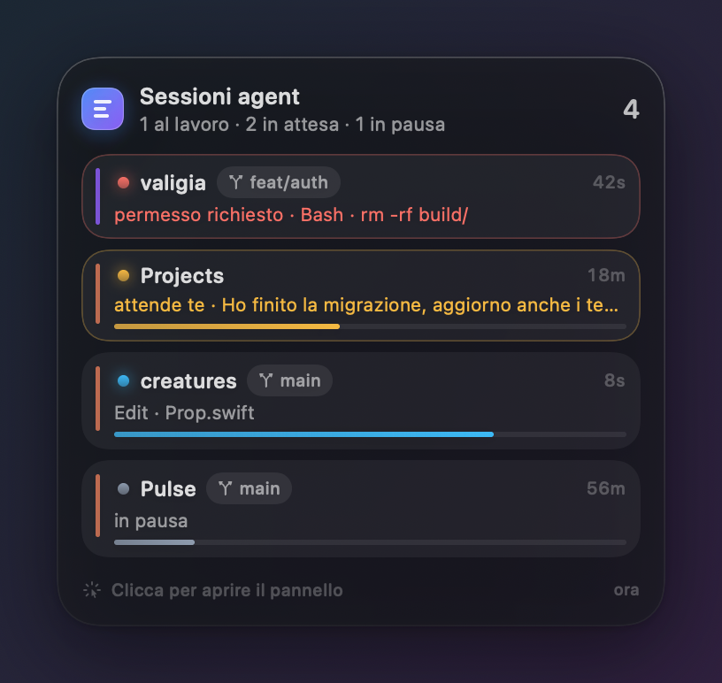
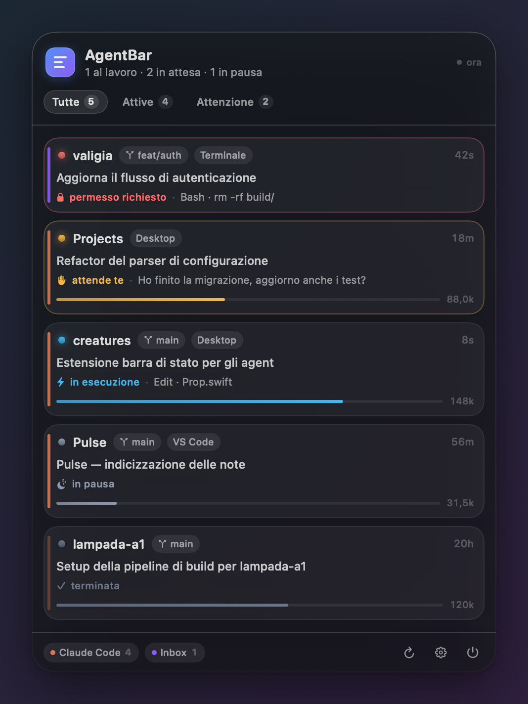
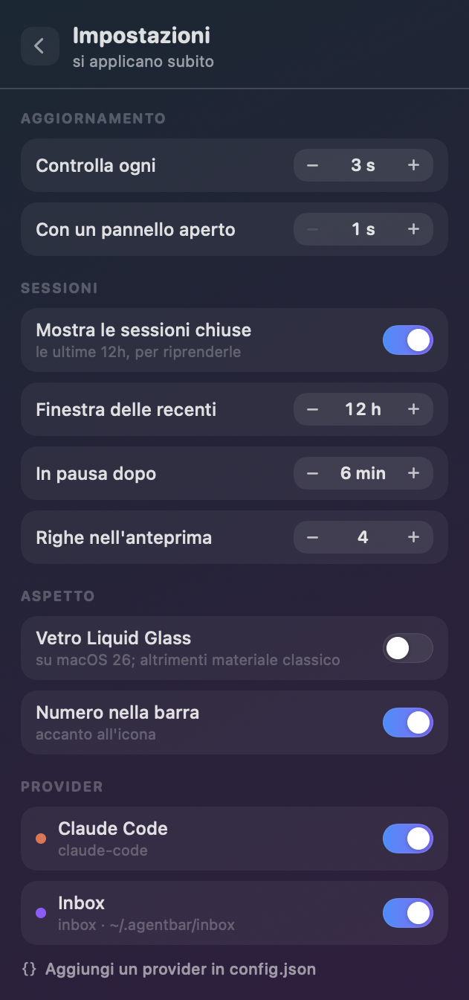

# AgentBar

Lo stato delle tue sessioni di coding agent nella barra dei menu di macOS.

Passi il mouse sull'icona e vedi **cosa sta facendo ogni sessione adesso**; ci
clicchi e ottieni un pannello con cui aprirle, riprenderle e portarle in primo
piano. Niente menu a tendina di sistema: sono due pannelli disegnati da zero,
in vetro, con animazioni a molla.

| Al passaggio del mouse | Al click | Impostazioni |
|---|---|---|
|  |  |  |

Funziona **senza configurare nulla** con Claude Code, e con qualunque altro
agent tramite tre punti di aggancio (vedi *Collegare un altro agent*).

---

## Installazione

```bash
cd ~/Projects/AgentBar && ./build.sh --install
```

L'app finisce in `~/Applications/AgentBar.app` e parte subito. Compare solo
nella barra dei menu: niente icona nel Dock.

Per avviarla a ogni accesso: pannello → ingranaggio → *Avvia al login*.

Requisiti: macOS 14 o successivo (su macOS 26 usa il vetro *Liquid Glass*),
Xcode installato per compilare.

---

## Come si usa

| Gesto | Effetto |
|---|---|
| Mouse sopra l'icona | Anteprima: fino a 4 sessioni con stato, attività e contesto usato |
| Click | Pannello completo: filtri, dettagli, azioni |
| Click su una card | Espande percorso, modello, provider, ultimo prompt |
| Mouse su una card | Mostra le azioni: Vai, Terminale, Editor, Finder, Copia, Rimuovi |
| **Vai** | Apre *quella* chat dentro Claude Desktop, non solo l'app |
| **Rimuovi** (occhio sbarrato) | Toglie la sessione dall'elenco, senza toccare l'agent |
| Click destro sull'icona | Menu di servizio: aggiorna, config, esci |
| `esc` | Chiude il pannello |

### Gli stati

| Stato | Significato |
|---|---|
| **in esecuzione** (blu) | L'agent sta lavorando: si vede anche il tool in uso |
| **attende te** (ambra) | Ha finito il turno, la palla è tua |
| **permesso richiesto** (rosso) | Bloccato in attesa di un'approvazione (serve l'hook, sotto) |
| **in pausa** (grigio) | Sessione aperta ma ferma da più di 6 minuti |
| **terminata** | Sessione chiusa di recente, riprendibile |

L'icona nella barra mostra il numero di sessioni vive e si colora quando una di
esse ha bisogno di te; le barrette "scrivono" quando qualcuno sta lavorando.

### Come "Vai" trova la chat giusta

Claude Desktop tiene la propria anagrafica delle chat in
`~/Library/Application Support/Claude/claude-code-sessions/`, dove ogni file
lega l'id della chat (`local_…`) all'id della sessione CLI (l'uuid del
transcript). AgentBar legge quella mappa e apre il deep link

```
claude://claude.ai/claude-code-desktop/<idChat>
```

che porta l'app esattamente dentro quella conversazione. Da lì arriva anche il
titolo che vedi nel pannello: è lo stesso che leggi dentro Claude.

Per le sessioni avviate da terminale (senza una chat nel desktop) "Vai" ripiega
sull'app che le ospita, e per quelle chiuse compare "Riprendi", che le riapre
con `claude --resume` in una finestra di Terminale.

Ogni azione che ti porta altrove — Vai, Terminale, Editor, Finder, Riprendi —
chiude il pannello: non resta aperto alle spalle dell'app che hai appena
aperto. Vale anche se il fuoco passa a un'altra app per vie traverse.

### Tenere l'elenco pulito

Il pulsante **Rimuovi** toglie una sessione dall'elenco quando non ti serve più
— tipicamente una chat di una settimana fa che continua a occupare spazio.

Non cancella niente: né la chat, né il transcript, né la sessione in Claude
Code. AgentBar si limita ad annotare *quando* l'hai rimossa. Finché quella
sessione resta ferma, sparisce; **appena ci riparli, torna da sola** nell'elenco.

Le rimozioni sopravvivono al riavvio dell'app (`~/.config/agentbar/dismissed.json`)
e si autocancellano dopo un mese. Per rimettere tutto: impostazioni → *Elenco* →
Ripristina.

---

## Collegare un altro agent

AgentBar non sa nulla di chi produce le sessioni: legge dei **provider**,
elencati in `~/.config/agentbar/config.json`. Ce ne sono di tre tipi.

### 1. `inbox` — chiunque scrive un file (il più semplice)

Ogni file JSON in `~/.agentbar/inbox/` è una sessione. Da uno script, un hook o
un agent:

```bash
extensions/agentbar-report --id build-api --title "Compilo il backend" \
    --status working --project api --path "$PWD" --activity "docker build ."

extensions/agentbar-report --id build-api --status attention --activity "serve una risposta"
extensions/agentbar-report --id build-api --remove
```

### 2. `command` — un comando che stampa JSON

AgentBar esegue il comando a ogni giro e mostra quello che stampa su stdout.
Template commentato in [`extensions/example-command-provider.py`](extensions/example-command-provider.py).

```json
{
  "id": "mio-agent",
  "type": "command",
  "name": "Mio Agent",
  "accent": "#22C55E",
  "command": "~/Projects/AgentBar/extensions/example-command-provider.py"
}
```

Con `"args": ["--json"]` il primo campo è trattato come eseguibile; senza `args`
la stringa passa dalla shell (pipe e variabili funzionano).

### 3. `claude-code` — il provider nativo

Incrocia il registro dei processi vivi (`~/.claude/sessions/<pid>.json`) con la
coda dei transcript (`~/.claude/projects/**/<sessionId>.jsonl`). Non richiede
hook, non scrive nulla, legge solo la coda dei file (256 KB) e mette in cache il
risultato finché il file non cambia.

### Lo schema di una sessione

Solo `id` è obbligatorio.

```jsonc
{
  "id": "sess-1",                   // stabile nel tempo: identifica la sessione
  "title": "Refactor autenticazione",
  "project": "api",                 // se manca: ultimo componente di path
  "path": "/Users/tu/dev/api",      // abilita Terminale/Editor/Finder/Copia
  "branch": "main",
  "model": "gpt-5",
  "status": "working",              // working | attention | blocked | idle | ended | error
  "activity": "Edit · auth.ts",     // riga sotto lo stato
  "detail": "testo lungo",          // mostrato quando la card è espansa
  "startedAt": "2026-08-03T09:00:00Z",  // ISO-8601, oppure epoch s/ms
  "updatedAt": 1785754830967,
  "tokens": { "used": 148320, "limit": 200000 },
  "pid": 4211,                      // se il processo muore, la sessione passa a "terminata"
  "provider": "Codex",              // nome mostrato al posto di quello del provider
  "accent": "#8B5CF6",              // colore della barretta laterale
  "openURL": "miaapp://session/42", // deep link aperto dal pulsante "Vai"
  "actions": [                      // pulsanti extra nella card espansa
    { "label": "Approva", "command": "mio-cli approve $AGENTBAR_SESSION", "symbol": "checkmark.circle" }
  ]
}
```

I comandi delle `actions` girano con `/bin/sh -lc` nella cartella della sessione,
con `$AGENTBAR_PATH`, `$AGENTBAR_SESSION` e `$AGENTBAR_PROVIDER` nell'ambiente.

Gli alias comuni degli stati sono accettati (`running`, `busy`, `waiting`,
`permission`, `done`, `failed`…).

---

## Hook opzionali per Claude Code

Il transcript non registra le richieste di permesso ancora pendenti: senza hook
una sessione bloccata su un'approvazione appare "in esecuzione". Gli hook
risolvono questo caso.

```bash
extensions/claude-code-hooks/install.sh      # installa
extensions/claude-code-hooks/install.sh --remove
```

L'installer **fonde** la configurazione in `~/.claude/settings.json` senza
toccare gli hook già presenti, e ne salva una copia in
`settings.json.agentbar-backup`. Gli hook scrivono un suggerimento in
`~/.agentbar/hints/<sessionId>.json` che il provider nativo sovrappone al
transcript; sono asincroni e non rallentano Claude Code.

---

## Configurazione

Le impostazioni di tutti i giorni stanno nel pannello: click sull'icona →
ingranaggio in basso a destra. Le modifiche si applicano subito e finiscono
comunque nel file, che resta la via per i casi avanzati (aggiungere provider).

`~/.config/agentbar/config.json`, riletto a caldo quando cambia.

| Campo | Default | Cosa fa |
|---|---|---|
| `refreshSeconds` | `3` | Intervallo di polling a pannelli chiusi |
| `activeRefreshSeconds` | `1` | Intervallo con un pannello aperto |
| `showRecent` | `true` | Mostra anche le sessioni chiuse di recente |
| `recentWindowHours` | `12` | Quanto indietro guardare per le sessioni chiuse |
| `maxPeekRows` | `4` | Righe nell'anteprima |
| `idleAfterMinutes` | `6` | Dopo quanti minuti di silenzio una sessione è "in pausa" |
| `defaultTokenLimit` | `200000` | Primo scaglione della barra di contesto |
| `useLiquidGlass` | `true` | Vetro di macOS 26; a `false` usa il materiale classico |
| `showCountInMenuBar` | `true` | Numero accanto all'icona |
| `providers` | claude-code + inbox | Elenco dei provider |

La finestra di contesto reale non è scritta nei transcript: la barra usa il primo
scaglione che contiene i token già consumati (200k → 500k → 1M → 2M). Il numero
accanto alla barra resta il dato certo.

---

## Sviluppo

```bash
swift build -c release
.build/release/AgentBar --dump              # cosa vedono i provider, in testo
.build/release/AgentBar --render ~/Desktop  # rende i pannelli in PNG, chiaro e scuro
.build/release/AgentBar --selftest          # verifica le regole delle sessioni nascoste
./build.sh --run                            # bundle in dist/ e avvio
```

Struttura:

```
Sources/AgentBar/
  Core/       modello, config, store, scanner dei transcript, azioni
  Providers/  claude-code, command, inbox
  UI/         icona di barra, pannelli, design system
  Dev/        --dump e --render
extensions/   agentbar-report, provider di esempio, hook di Claude Code
```

## Limiti noti

- Le sessioni di Claude Code sono lette dal disco: gli aggiornamenti arrivano
  entro un giro di polling (1–3 secondi), non in tempo reale.
- Senza gli hook, "permesso richiesto" non viene distinto da "in esecuzione".
- "Vai" apre la chat esatta solo per le sessioni che Claude Desktop conosce;
  quelle nate in terminale portano all'app ospite.
- `--render` disegna i pannelli con il materiale classico: `ImageRenderer` non
  sa disegnare il vetro né il contenuto di uno `ScrollView`.
