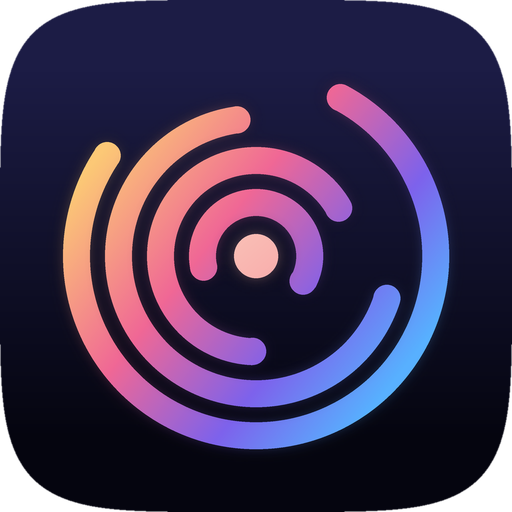
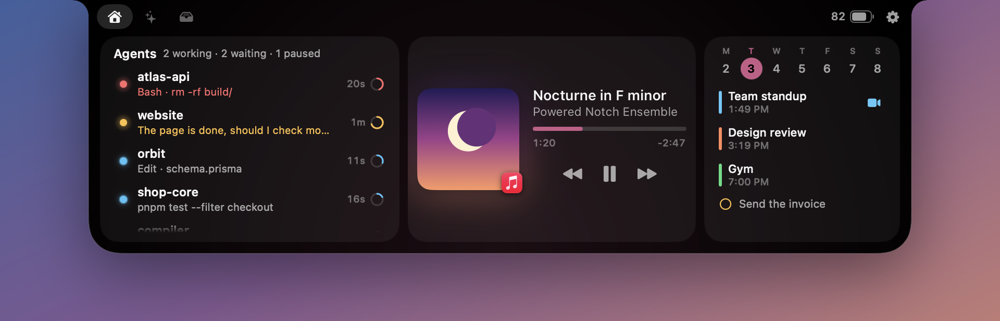
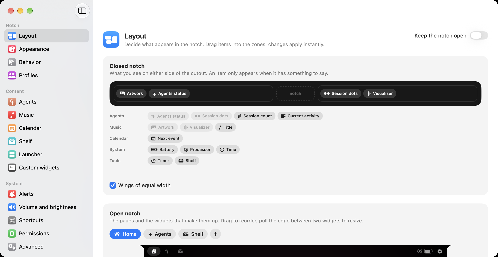
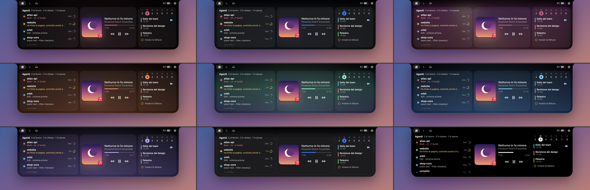
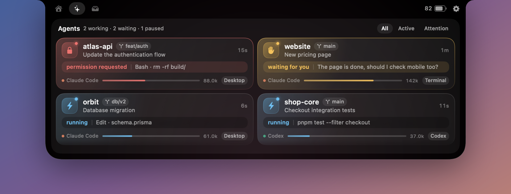

<p align="center"></p>

<h1 align="center">Orbit</h1>

<p align="center">Your Mac's notch, made your way.<br>Music, calendar, a shelf for files, and the sessions of your coding agents, always in view.</p>

<p align="center">
  
  
  
</p>



Orbit takes its starting point from [Boring Notch](https://github.com/TheBoredTeam/boring.notch) and is written from scratch with three extra ideas: **everything can be moved, removed and added**, it feels like a part of macOS, and it knows what your coding agents are doing.

| Closed notch: it only widens when it has something to say | An agent calls for you |
|---|---|
|  |  |

> **Languages.** The interface is available in **English, Italian, Spanish, French and German**. It follows your system language and can be switched at any time, instantly, from Settings → Behavior → Interface language.

---

## Installation

**Download.** Get `Orbit.dmg` from the [latest release](https://github.com/romeofrancesc0/orbit/releases/latest) or from the [website](https://www.romeo-francesco.it/orbit), open it and drag the app into Applications. It runs on Apple Silicon and Intel. The app is not notarized by Apple yet, so the first time macOS says it can't verify the developer: go to System Settings → Privacy & Security and click **Open Anyway**.

**Updates.** Once installed, Orbit keeps itself up to date: once a day it checks for a new release on GitHub, and with your OK it downloads it, verifies its signature and installs it. Settings → Behavior → Updates turns the daily check off; *Check for Updates…* is in the notch's menu.

**Build from source.** You need Xcode and [XcodeGen](https://github.com/yonaskolb/XcodeGen).

```bash
brew install xcodegen
git clone https://github.com/romeofrancesc0/orbit.git
cd orbit
./build.sh --install
```

The app lands in `~/Applications/Orbit.app` and starts right away.

**Requirements:** macOS 14 or later. On macOS 26 and 27 it uses Liquid Glass.

**Code signing.** `build.sh` signs with the first *Apple Development* certificate it finds in your keychain. To choose another one, set `ORBIT_SIGN_IDENTITY`. With no certificate it falls back to ad-hoc signing, which works but makes macOS ask for permissions again after every build.

**If you use Boring Notch,** quit it: two apps on the same notch cover each other. Orbit notices and offers a button to do it for you.

---

## What's inside

| | |
|---|---|
| **Agents** | The sessions of Claude Code and Codex, with no configuration. Status, current activity and context used, and one click takes you to the right chat. |
| **Music** | Any app that plays: Music, Spotify, Safari, YouTube. Artwork, draggable progress, a visualizer, and colors taken from the cover. |
| **Calendar** | The week, your events and reminders, and a button to join meetings. |
| **Shelf** | Drag files, links or text onto the notch and find them there again. With AirDrop, Quick Look and system sharing. |
| **Volume and brightness** | Replaces the system indicators with ones in the notch: a fluid meter that reacts to every key press, with a handle that pops out while you adjust and a bounce at the limits. |
| **Alerts** | Discreet by default: only what needs you (a permission, an error) comes down. The rest stays in the closed notch as a glow and dots. Charger, Bluetooth, track changes, events and timers are opt-in. |
| **More widgets** | Mirror, battery, system stats, clipboard, timer, notes, launcher, clock. |
| **Your own widgets** | If you can write it in a script, you can put it in the notch. |
| **Five languages** | English, Italian, Spanish, French and German, switchable live from the settings. |

---

## Customize everything

Customization is the reason Orbit exists. Right-click the notch → *Customize the notch*.



**Closed notch.** Two zones on either side of the cutout: drag whatever you want into them. An item only shows up when it has something to say, so the notch stays invisible until it's needed.

**Open notch.** Create as many pages as you like and fill them with widgets. Drag to reorder, pull the edge between two widgets to resize them, stack two in the same column. The preview is the real notch: what you see is what you get.

**Appearance.** Nine themes as a starting point, then every detail: material (solid, gradient, Liquid Glass, cover art), accent, corners, sizes, shadow, border, glow, cards, typeface, and the speed and style of the animations.



**Profiles.** A profile remembers appearance and layout. Switch with a click, a keyboard shortcut, a Shortcuts action or a **Focus filter**: agents at work, music in the evening, without touching anything. Profiles can be exported and imported as files.

**Behavior.** Open on hover or only on click, delays, trackpad gestures, haptic feedback, which displays to use, full-screen apps, screen recording, global shortcuts.

**Everything is a file.** `~/.config/orbit/config.json`: edit it by hand and the notch updates by itself. A missing key falls back to its default, and an unreadable section doesn't take the others down with it.

---

## Coding agents



Out of the box they appear in the closed notch, on the first page, and on a page of their own. To put them front and center: Settings → Agents → *Open the notch directly on agents*.

Each session is a card: a status badge, the project and branch, what the agent is doing right now, and how much of its context window is used. Hover a card for its actions (go to the chat, resume, open in Terminal, your editor or Finder, hide); right-click for the full menu.

| Status | Meaning |
|---|---|
| **running** (blue, *in esecuzione*) | The agent is working. The tool in use is shown too. |
| **waiting for you** (amber, *attende te*) | The agent genuinely needs you: it asked a question (a closing "?" or the question tool) or wants a plan approved. |
| **done** (green, *finita*) | It finished its turn without asking anything. Shown, but it never lights the notch. |
| **permission requested** (red, *permesso richiesto*) | Blocked, waiting for an approval (needs the hook, see below). |
| **paused** (gray, *in pausa*) | Session still open but silent for more than 6 minutes, whatever it was doing before. |
| **ended** | Recently closed session, can be resumed. |

When an agent moves to *waiting for you* or *permission requested*, the notch drops an alert, glows until the situation changes, and a click takes you **into that very chat**: Claude Desktop and Codex have direct deep links.

Opening a session (or choosing *Mark as seen* in its menu) quiets it until something new happens in that chat, so a question you already dealt with stops calling you. Running sessions and the ones that need you get full cards; the rest (done, paused, ended) collapse into compact rows under *Other sessions*.

Updates arrive through FSEvents as soon as files change, with no constant polling of the disk.

### Claude Code hooks

The transcript doesn't record permission requests that are still pending: without the hook, a blocked session looks "running". Settings → Agents → **Install**.

The installer **merges** its configuration into `~/.claude/settings.json` without touching the hooks already there, and saves a copy as `settings.json.orbit-backup`. The hooks are asynchronous and don't slow Claude Code down. Nothing is installed unless you ask for it. You can also run `extensions/claude-code-hooks/install.sh` (and `install.sh --remove`) by hand.

### Connecting another agent

Orbit knows nothing about whoever produces the sessions: it reads **providers**, which you add from Settings → Agents.

**`inbox`: anyone writes a file.** Every JSON file in `~/.orbit/inbox/` is a session.

```bash
extensions/orbit-report --id build-api --title "Building the backend" \
    --status working --project api --path "$PWD" --activity "docker build ."

extensions/orbit-report --id build-api --status attention --activity "needs an answer"
extensions/orbit-report --id build-api --remove
```

**`command`: a command that prints JSON.** Orbit runs it on every round. A commented template lives in [`extensions/example-command-provider.py`](extensions/example-command-provider.py).

The schema of a session (only `id` is required):

```jsonc
{
  "id": "sess-1",                   // stable over time: identifies the session
  "title": "Refactor authentication",
  "project": "api",                 // if missing: the last component of path
  "path": "/Users/you/dev/api",     // enables Terminal / Editor / Finder / Copy
  "branch": "main",
  "model": "gpt-5",
  "status": "working",              // working | attention | done | blocked | idle | ended | error
  "activity": "Edit · auth.ts",     // the line under the status
  "detail": "long text",
  "startedAt": "2026-08-03T09:00:00Z",  // ISO-8601, or epoch seconds/milliseconds
  "updatedAt": 1785754830967,
  "tokens": { "used": 148320, "limit": 200000 },
  "pid": 4211,                      // if the process dies, the session becomes "ended"
  "provider": "Codex",              // name shown instead of the provider's own
  "accent": "#8B5CF6",              // the provider's accent color
  "openURL": "myapp://session/42",  // deep link opened by the click
  "actions": [                      // extra entries in the context menu
    { "label": "Approve", "command": "my-cli approve $ORBIT_SESSION", "symbol": "checkmark.circle" }
  ]
}
```

The commands in `actions` run with `/bin/sh -lc` in the session's folder, with `$ORBIT_PATH`, `$ORBIT_SESSION` and `$ORBIT_PROVIDER` in the environment.

---

## Widgets from scripts

Settings → Custom widgets. The command prints text (the first line is the value, the others go below it) or JSON:

```json
{
  "text": "22°", "subtitle": "Milan",
  "symbol": "sun.max.fill", "tint": "#FFD60A",
  "progress": 0.4,
  "rows": [{ "title": "Tomorrow", "value": "19°", "symbol": "cloud.fill" }],
  "url": "https://…",
  "compact": "22°", "active": true
}
```

The widget shows up among the available ones in Layout, both as a widget and in the closed notch. Ready-made templates exist for weather, pull requests, uptime and public IP.

---

## macOS integration

- **Shortcuts, Spotlight and Siri:** open a page, send an alert, start a timer, switch profile, count the active sessions.
- **Focus filters:** every Focus can have its own profile.
- **Liquid Glass** in the settings, in the icon and, if you want, in the notch itself.
- **Reduce Motion** and the other system accessibility controls are respected.
- **`orbit://`** for your own scripts. It only exposes harmless actions and never runs commands:

```bash
open 'orbit://peek?title=Build&subtitle=Done&symbol=hammer.fill&tint=%234ADE80'
```

| Action | Parameters |
|---|---|
| `open` | `page` |
| `close`, `toggle` | |
| `peek` | `title`, `subtitle`, `symbol`, `tint`, `duration`, `group` |
| `hud` | `kind` (`volume`, `brightness`, `keyboard`), `level` |
| `profile` | `id` |
| `theme` | `id` |
| `language` | `id` (`system`, `en`, `it`, `es`, `fr`, `de`) |
| `settings` | `section` |
| `quiet` | `on` (`1` silences, `0` unsilences, no parameter toggles) |

---

## Discreet alerts

An alert that drops on every change turns into noise quickly, so:

- **Automatic quiet.** While you watch a video (a foreground app that does more than play music) or, if you choose, with a full-screen app, alerts neither drop nor get queued for later. The glow and dots in the closed notch remain.
- **Manual quiet.** Right-click the notch → *Silence alerts*, the `orbit://quiet` link, or the Shortcuts action. macOS doesn't let apps read your Focus, so to tie it to one, create an automation "when I turn on this Focus → silence the notch alerts".
- **Stable states.** An agent only alerts if its new state holds for a few seconds, and the same session never alerts more than once a minute. Tune it in Settings → Alerts.
- **Videos stay out of the wings.** Artwork and the visualizer appear in the closed notch only for music apps, not for a video in the browser.

---

## Gestures

| Gesture | Effect |
|---|---|
| Mouse over the notch | Opens it |
| Two fingers down on the notch | Opens it |
| Two fingers sideways | Changes page |
| Two fingers up on the header | Closes it |
| Click a session | Takes you to the chat |
| Right-click a session | Terminal, editor, Finder, copy path, hide from the list |
| Right-click the notch | Customize, profiles, settings |
| `⌃⌥N` | Opens or closes the notch |
| `⌃⌥A` | Opens the agents page |
| `esc` | Closes it |

---

## Resource usage

In the closed notch, everything that moves (dots, visualizer, icon, scrolling text) is a Core Animation animation: it runs on the GPU without waking the app, which at rest stays under 1% CPU even with several sessions at work. Every module runs only if it's in your layout: remove music and the Now Playing bridge doesn't even start.

---

## Permissions and privacy

Orbit asks only for what the features you use need, when you use them. Nothing leaves your Mac, apart from whatever the script widgets you add yourself do. The only request the app makes on its own is the daily update check, which downloads a small feed from GitHub and sends nothing about you; you can turn it off in Settings → Behavior.

| Permission | Used for |
|---|---|
| Calendar, Reminders | The Calendar widget |
| Camera | The Mirror widget, only while you're looking at it |
| Accessibility | Only to replace the volume and brightness indicators |
| Bluetooth | Only for device alerts, which are off by default |

The clipboard history lives in memory only and skips anything apps mark as confidential, such as passwords copied from a password manager. Notes and the shelf stay in `~/.config/orbit/`.

---

## Development

```bash
scripts/release.sh --publish 1.0.1           # new version: universal .dmg + update feed, published as a GitHub release
./build.sh --run                              # bundle in dist/ and launch
dist/Orbit.app/Contents/MacOS/Orbit --selftest         # check the rules you can't see by eye
dist/Orbit.app/Contents/MacOS/Orbit --dump             # what the agent providers see
dist/Orbit.app/Contents/MacOS/Orbit --probe-controls   # volume, brightness, calendar
open dist/Orbit.app --args --demo           # the notch with made-up data, for screenshots
open dist/Orbit.app --args --demo --language=de   # …in another language, without touching your settings
open dist/Orbit.app --args --virtual-notch  # as on a display without a notch
```

The Xcode project is generated from `project.yml`. It needs Xcode and not just SwiftPM because Shortcuts and Focus filters require metadata that only Xcode's build system generates.

```
Sources/Orbit/
  App/        launch, services, menus, orbit:// links, Shortcuts
  Config/     the model of everything you can customize
  Notch/      window, shape, state, mouse and gestures, volume/brightness HUD
  Modules/    music, calendar, shelf, widgets, catalog
  Agents/     session model, providers and session cards
  Settings/   settings and the layout editor
  System/     volume, brightness, keys, shortcuts, Bluetooth, camera
  UI/         components and theme
  Localization/   language selection and string lookup
  Dev/        diagnostics and demo data
Sources/OrbitMediaBridge/   bridge to Now Playing
extensions/   orbit-report, an example provider, Claude Code hooks
scripts/      release.sh: the downloadable disk image and the update feed (Sparkle)
```

### Now Playing

Since macOS 15.4, MediaRemote answers with empty data to ordinary processes. That's why `OrbitMediaBridge` is loaded by `/usr/bin/perl`, which still has access, and writes a line of JSON on every change. Commands (play, next, scrub) don't have this limit and go straight from the app.

## Known limitations

- It uses private APIs for Now Playing, brightness, full-screen spaces and the lock screen. They are loaded at runtime: if a macOS update removed them, that feature would stop working but the app would not. For the same reason it can't be in the Mac App Store.
- Ad-hoc signing makes macOS forget permissions on every build. `build.sh` uses an Apple Development certificate if it finds one, or the one named in `ORBIT_SIGN_IDENTITY`.
- Without the hooks, "permission requested" can't be told apart from "running".
- The music visualizer is a timed animation, not an audio analysis: doing that would require the permission to record system audio.
- "Show on the lock screen" is experimental.
- The comments in the source code are in Italian.
- Shortcuts, Spotlight and the permission prompts follow the *system* language, not the one chosen inside the app: macOS reads their text from the app bundle before the app is running.

## Contributing

Issues and pull requests are welcome.

**Translations.** Every user-facing string lives in `Resources/Localization/<language>.lproj/Localizable.strings`. The key is the original Italian text, which is also what the code contains, so Italian needs no table of its own. To fix a translation, edit the matching line. To add a language, add a `<code>.lproj` folder with a `Localizable.strings` and an `InfoPlist.strings`, add the code to `AppLanguage` in `Sources/Orbit/Localization/Localization.swift`, and to `CFBundleLocalizations` in `project.yml`. In code, wrap strings you build by hand in `tr("…")`; SwiftUI `Text("…")` literals are looked up automatically.

## Acknowledgments

The idea and the feature list come from [Boring Notch](https://github.com/TheBoredTeam/boring.notch) (GPL-3.0). Orbit does not reuse its code: it is written from scratch, consulting Boring Notch only to learn which system APIs still work.

## License

[MIT](LICENSE) © 2026 Francesco Romeo
