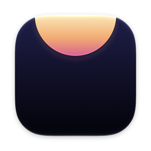
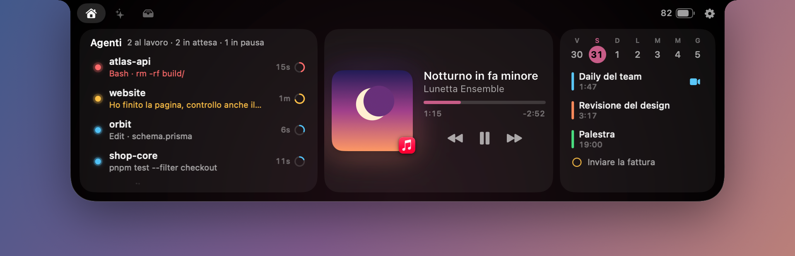
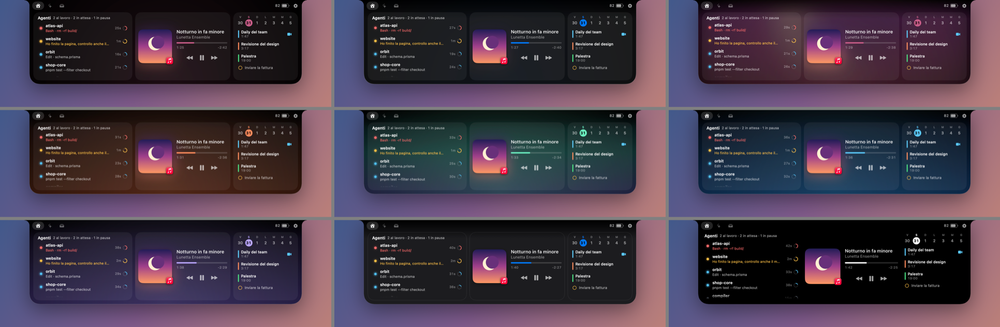
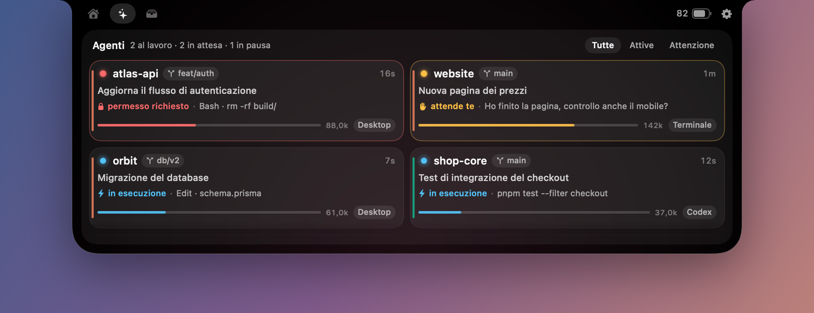

<p align="center"></p>

<h1 align="center">Lunetta</h1>

<p align="center">La notch del tuo Mac, fatta a modo tuo.<br>Musica, calendario, scaffale e le sessioni dei tuoi coding agent, sempre sotto gli occhi.</p>



La *lunetta* è la finestra a mezzaluna sopra una porta, la ghiera di un orologio, una piccola luna: una forma che pende dall'alto, come la notch.

Lunetta è la notch di [Boring Notch](https://github.com/TheBoredTeam/boring.notch), scritta da zero con tre idee in più: **ogni cosa si può spostare, togliere e aggiungere**, sembra una parte di macOS, e sa cosa stanno facendo i tuoi agenti.

| Notch chiusa: si allarga solo se ha qualcosa da dire | Un agente ti chiama |
|---|---|
|  |  |

---

## Installazione

Servono Xcode e [XcodeGen](https://github.com/yonaskolb/XcodeGen).

```bash
brew install xcodegen
```

```bash
./build.sh --install
```

L'app finisce in `~/Applications/Lunetta.app` e parte subito. Requisiti: macOS 14 o successivo; su macOS 26 e 27 usa Liquid Glass.

**Se usi Boring Notch**, chiudilo: due app sulla stessa notch si coprono a vicenda. Lunetta se ne accorge e ti offre un pulsante per farlo.

---

## Cosa c'è dentro

| | |
|---|---|
| **Agenti** | Le sessioni di Claude Code e Codex, senza configurare nulla. Stato, attività, contesto usato, e un click ti porta nella chat giusta. |
| **Musica** | Qualunque app che riproduce: Musica, Spotify, Safari, YouTube. Copertina, avanzamento trascinabile, visualizzatore, colori dalla copertina. |
| **Calendario** | La settimana, gli eventi, i promemoria, il pulsante per entrare nelle riunioni. |
| **Scaffale** | Trascina file, link o testo sulla notch e li ritrovi lì. Con AirDrop, Quick Look e condivisione di sistema. |
| **Volume e luminosità** | Sostituisce gli indicatori di sistema con quelli nella notch. |
| **Avvisi** | Caricatore, Bluetooth, cambio brano, eventi in arrivo, timer: scegli tu cosa merita di interromperti. |
| **Altri widget** | Specchio, batteria, sistema, appunti, timer, note, collegamenti, orologio. |
| **I tuoi widget** | Se lo puoi scrivere in uno script, lo puoi mettere nella notch. |

---

## Personalizzare tutto

La personalizzazione è il motivo per cui esiste Lunetta. Tasto destro sulla notch → **Personalizza la notch**.


**Notch chiusa.** Due zone ai lati del ritaglio: ci trascini quello che vuoi. Un elemento compare solo quando ha qualcosa da dire, così la notch resta invisibile finché non serve.

**Notch aperta.** Crea tutte le pagine che vuoi e riempile di widget. Trascina per riordinare, tira il bordo fra due widget per ridimensionarli, impilane due nella stessa colonna. L'anteprima è la notch vera: quello che vedi è quello che otterrai.

**Aspetto.** Nove temi come punto di partenza, poi ogni dettaglio: materiale (tinta unita, sfumatura, Liquid Glass, copertina), accento, angoli, misure, ombra, bordo, luce, card, carattere, velocità e stile delle animazioni.



**Profili.** Un profilo ricorda aspetto e layout. Cambialo con un click, con una scorciatoia, con un Comando rapido o con un **filtro Full Immersion**: al lavoro gli agenti, la sera la musica, senza toccare nulla. Si possono esportare e importare come file.

**Comportamento.** Apertura al passaggio del mouse o solo con un click, ritardi, gesti del trackpad, risposta tattile, quali schermi, tutto schermo, registrazioni dello schermo, scorciatoie globali.

**Tutto è un file.** `~/.config/lunetta/config.json`: modificalo a mano e la notch si aggiorna da sola. Una chiave mancante prende il valore predefinito, una sezione illeggibile non trascina giù le altre.

---

## I coding agent



Di serie compaiono nella notch chiusa, nella prima pagina e in una pagina tutta loro. Per metterli in primo piano: Impostazioni → Agenti → *Apri la notch direttamente sugli agenti*.

| Stato | Significato |
|---|---|
| **in esecuzione** (blu) | L'agent sta lavorando: si vede anche il tool in uso |
| **attende te** (ambra) | Ha finito il turno, la palla è tua |
| **permesso richiesto** (rosso) | Bloccato in attesa di un'approvazione (serve l'hook, sotto) |
| **in pausa** (grigio) | Sessione aperta ma ferma da più di 6 minuti |
| **terminata** | Sessione chiusa di recente, riprendibile |

Quando un agente passa a *attende te* o *permesso richiesto* la notch fa scendere un avviso, si illumina finché la situazione non cambia e con un click ti porta **dentro quella chat**: Claude Desktop e Codex hanno il deep link diretto.

Gli aggiornamenti arrivano da FSEvents appena i file cambiano, senza interrogare il disco di continuo.

### Hook di Claude Code

Il transcript non registra le richieste di permesso ancora pendenti: senza hook una sessione bloccata appare "in esecuzione". Impostazioni → Agenti → **Installa**.

L'installazione **fonde** la configurazione in `~/.claude/settings.json` senza toccare gli hook già presenti e ne salva una copia in `settings.json.lunetta-backup`. Gli hook sono asincroni e non rallentano Claude Code. Parte solo se lo chiedi tu.

### Collegare un altro agent

Lunetta non sa nulla di chi produce le sessioni: legge dei **provider**, che si aggiungono da Impostazioni → Agenti.

**`inbox`: chiunque scrive un file.** Ogni file JSON in `~/.lunetta/inbox/` è una sessione.

```bash
extensions/lunetta-report --id build-api --title "Compilo il backend" \
    --status working --project api --path "$PWD" --activity "docker build ."

extensions/lunetta-report --id build-api --status attention --activity "serve una risposta"
extensions/lunetta-report --id build-api --remove
```

**`command`: un comando che stampa JSON.** Lunetta lo esegue a ogni giro. Template commentato in [`extensions/example-command-provider.py`](extensions/example-command-provider.py).

Lo schema di una sessione (solo `id` è obbligatorio):

```jsonc
{
  "id": "sess-1",                   // stabile nel tempo: identifica la sessione
  "title": "Refactor autenticazione",
  "project": "api",                 // se manca: ultimo componente di path
  "path": "/Users/tu/dev/api",      // abilita Terminale/Editor/Finder/Copia
  "branch": "main",
  "model": "gpt-5",
  "status": "working",              // working | attention | blocked | idle | ended | error
  "activity": "Edit · auth.ts",     // riga sotto lo stato
  "detail": "testo lungo",
  "startedAt": "2026-08-03T09:00:00Z",  // ISO-8601, oppure epoch s/ms
  "updatedAt": 1785754830967,
  "tokens": { "used": 148320, "limit": 200000 },
  "pid": 4211,                      // se il processo muore, la sessione passa a "terminata"
  "provider": "Codex",              // nome mostrato al posto di quello del provider
  "accent": "#8B5CF6",              // colore della barretta laterale
  "openURL": "miaapp://session/42", // deep link aperto dal click
  "actions": [                      // voci extra nel menu contestuale
    { "label": "Approva", "command": "mio-cli approve $LUNETTA_SESSION", "symbol": "checkmark.circle" }
  ]
}
```

I comandi delle `actions` girano con `/bin/sh -lc` nella cartella della sessione, con `$LUNETTA_PATH`, `$LUNETTA_SESSION` e `$LUNETTA_PROVIDER` nell'ambiente.

---

## Widget da script

Impostazioni → Widget personalizzati. Il comando stampa testo (la prima riga è il valore, le altre vanno sotto) oppure JSON:

```json
{
  "text": "22°", "subtitle": "Milano",
  "symbol": "sun.max.fill", "tint": "#FFD60A",
  "progress": 0.4,
  "rows": [{ "title": "Domani", "value": "19°", "symbol": "cloud.fill" }],
  "url": "https://…",
  "compact": "22°", "active": true
}
```

Il widget compare fra quelli disponibili in Layout, sia come widget sia nella notch chiusa. Ci sono modelli pronti per meteo, pull request, uptime e IP pubblico.

---

## Integrazione con macOS

- **Comandi rapidi, Spotlight e Siri**: apri una pagina, manda un avviso, avvia un timer, cambia profilo, conta le sessioni attive.
- **Filtri Full Immersion**: ogni modalità può avere il suo profilo.
- **Liquid Glass** nelle impostazioni, nell'icona e, se vuoi, nella notch stessa.
- **Riduci movimento** e gli altri controlli di sistema vengono rispettati.
- **`lunetta://`** per i tuoi script. Espone solo azioni innocue, mai l'esecuzione di comandi:

```bash
open 'lunetta://peek?title=Build&subtitle=Finita&symbol=hammer.fill&tint=%234ADE80'
```

| Azione | Parametri |
|---|---|
| `open` | `page` |
| `close`, `toggle` | |
| `peek` | `title`, `subtitle`, `symbol`, `tint`, `duration`, `group` |
| `hud` | `kind` (`volume`, `brightness`, `keyboard`), `level` |
| `profile` | `id` |
| `theme` | `id` |
| `settings` | `section` |

---

## Gesti

| Gesto | Effetto |
|---|---|
| Mouse sulla notch | Si apre |
| Due dita in giù sulla notch | Si apre |
| Due dita di lato | Cambia pagina |
| Due dita in su sulla testata | Si chiude |
| Click su una sessione | Ti porta nella chat |
| Tasto destro su una sessione | Terminale, editor, Finder, copia percorso, togli dall'elenco |
| Tasto destro sulla notch | Personalizza, profili, impostazioni |
| `⌃⌥N` | Apre o chiude la notch |
| `⌃⌥A` | Apre gli agenti |
| `esc` | Chiude |

---

## Consumi

Nella notch chiusa tutto ciò che si muove (pallini, visualizzatore, icona, testo che scorre) è un'animazione di Core Animation: gira sulla GPU senza svegliare l'app, che a riposo sta sotto l'1% di CPU anche con diverse sessioni al lavoro. Ogni modulo gira solo se è nel tuo layout: se togli la musica, il ponte verso Now Playing non parte nemmeno.

---

## Permessi e riservatezza

Lunetta chiede solo ciò che serve a ciò che usi, quando lo usi. Nulla esce dal tuo Mac, a parte quello che fanno i widget da script che aggiungi tu.

| Permesso | Serve per |
|---|---|
| Calendario, Promemoria | Il widget Calendario |
| Fotocamera | Il widget Specchio, solo mentre lo guardi |
| Accessibilità | Solo per sostituire gli indicatori di volume e luminosità |
| Bluetooth | Solo per gli avvisi sui dispositivi, spenti di serie |

Gli appunti restano solo in memoria e saltano ciò che le app segnano come riservato, per esempio le password copiate da un gestore. Le note e lo scaffale restano in `~/.config/lunetta/`.

---

## Sviluppo

```bash
./build.sh --run                              # bundle in dist/ e avvio
dist/Lunetta.app/Contents/MacOS/Lunetta --selftest         # verifica le regole che non si vedono a occhio
dist/Lunetta.app/Contents/MacOS/Lunetta --dump             # cosa vedono i provider di agenti
dist/Lunetta.app/Contents/MacOS/Lunetta --probe-controls   # volume, luminosità, calendario
open dist/Lunetta.app --args --demo           # la notch con dati inventati, per gli screenshot
open dist/Lunetta.app --args --virtual-notch  # come su uno schermo senza notch
```

Il progetto Xcode si genera da `project.yml`. Serve Xcode e non solo SwiftPM perché Comandi rapidi e filtri Full Immersion richiedono i metadati che genera solo il suo build system.

```
Sources/Lunetta/
  App/        avvio, servizi, menu, link lunetta://, Comandi rapidi
  Config/     il modello di tutto ciò che si personalizza
  Notch/      finestra, forma, stati, mouse e gesti
  Modules/    musica, calendario, scaffale, widget, catalogo
  Agents/     modello delle sessioni e provider
  Settings/   impostazioni ed editor del layout
  System/     volume, luminosità, tasti, scorciatoie, Bluetooth, fotocamera
  UI/         componenti e tema
  Dev/        diagnostica e dati dimostrativi
Sources/LunettaMediaBridge/   ponte verso Now Playing
extensions/   lunetta-report, provider di esempio, hook di Claude Code
```

### Now Playing

Da macOS 15.4 MediaRemote risponde con dati vuoti ai processi qualunque. Per questo `LunettaMediaBridge` viene caricato da `/usr/bin/perl`, che ha ancora accesso, e scrive una riga JSON a ogni cambiamento. I comandi (play, avanti, scrub) non hanno questo limite e partono direttamente dall'app.

## Limiti noti

- Usa API private per Now Playing, luminosità, spazi a tutto schermo e schermata di blocco. Sono caricate a runtime: se un aggiornamento di macOS le togliesse, quella funzione smetterebbe di funzionare ma l'app no. Per lo stesso motivo non può stare nel Mac App Store.
- La firma ad-hoc fa perdere i permessi a ogni build: `build.sh` usa un certificato Apple Development se lo trova, oppure quello indicato in `LUNETTA_SIGN_IDENTITY`.
- Senza gli hook, "permesso richiesto" non viene distinto da "in esecuzione".
- Il visualizzatore musicale è un'animazione a tempo, non analizza l'audio: farlo richiederebbe il permesso di registrare l'audio di sistema.
- "Mostra sulla schermata di blocco" è sperimentale.

## Ringraziamenti

L'idea e l'elenco delle funzioni vengono da [Boring Notch](https://github.com/TheBoredTeam/boring.notch) (GPL-3.0). Lunetta non ne riusa il codice: è scritta da zero, consultandolo solo per capire quali API di sistema funzionano ancora.
